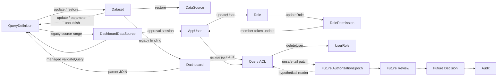

# AuthorizationEpoch Writer／Lock 契約（2B-3C-1D-B3-B3）

基準 `e08f116f362854e120049abf0156eb8cfd82708a`；開工 PR #66 為 Draft、未 Merge，CI #876 成功。僅新增 [隔離契約／鎖圖](../server/src/modules/dataset/nativeTypeWriterLocks.ts) 與 [合成測試](../server/src/modules/dataset/nativeTypeWriterLocks.test.ts)，未修改正式 Writer、[B2 Ports](../server/src/modules/dataset/nativeTypeReview.ports.ts) 或執行 DB 操作。[B3-A](sqlserver-native-type-b3a-feasibility-review.md)、[B3-B2](sqlserver-native-type-decision-audit-contract-2b3c1d-b3b2.md) 阻擋繼續成立。

**結論：現有 Writer 的共同鎖順序與正式確認 BLOCKED。** 已有反向 source dependencies，加上 SQL plan／FK／空範圍／旁路尚未驗證，不能藉尾端 touch AE 或合成 DAG 測試宣稱安全。GO 僅適用本次純分析／合成模型；共同偏序只能作未來改造假說，不可進入 Migration／正式 Repository。

## 1. Writer Coverage Matrix

AE＝全域授權 mutation revision；Q＝每 Query 的綁定／可用性 revision（**未建立**）；D＝920 Dataset.DefinitionRowVersion；S＝921 DataSource.ConfigurationRowVersion。TokenVersion 是各身份 session revision，不能代替 AE。COVERED 只表示具名路徑已有該**局部**推進；GAP＝發現缺口；UNKNOWN＝未能證明，均不得過正式 gate。D/S 須正確安裝 920/921，不能只看欄位名稱。

Tx owner：下列 `本函式/SER` 是程式明示自建 SERIALIZABLE；`本函式/DEFAULT` 僅呼叫 begin()，不採認 deployment/driver isolation；`AUTO` 是 pool request 單句、沒有覆蓋前後檢查的 owned transaction；`parent` 由 caller 傳入、helper 本身不能證明 isolation。`→` 是**持鎖後的接續 statement 存取依賴**，不聲稱 JOIN／子查詢／FK 內實體鎖取得順序。範圍／空結果與 plan 均見第 2 節。

| 資料物件 | Writer／具體程式 | owner／isolation | 已知順序與條件 | 現有推進 | 應負責的 revision | 旁路／覆蓋與風險 |
| --- | --- | --- | --- | --- | --- | --- |
| RoleQueryAccess／UserQueryAccess 新增、整批覆寫、刪除 | [replaceQueryAccess](../server/src/modules/queryDefinition/queryAccess.repository.ts#L61) | 本函式/DEFAULT | Query 存在性讀取→Dashboard evidence UPDATE→Role ACL DELETE→User ACL DELETE→role/user INSERT；初始 RC 型讀取不能當持鎖保證；UPDATE 的 source EXISTS／FK 順序 UNKNOWN | 同交易更新有關 Dashboard Approval RV；pre-919 可直接 return；ACL hash 非世代 | AE；保留 Dashboard→ACL | **GAP**；deleteUser／Query cascade／直接 SQL 繞過 helper；未 SER、無 AE/CAS；多 Dashboard UPDATE 無已證明 PK 鎖序 |
| 初始 AppUser／UserRole | [createInitialAdmin](../server/src/modules/admin/admin.repository.ts#L17) | 本函式/SER | AppUser count UPDLOCK/HOLDLOCK→INSERT user→UserRole SELECT Role | 初始 TokenVersion | AE 初始化／平台 incarnation | **GAP**；bootstrap／restore 邊界未綁定 review |
| AppUser／UserRole 建立 | [createUser](../server/src/modules/admin/admin.repository.ts#L130) | 本函式/DEFAULT | AppUser INSERT→UserRole INSERT SELECT Role（輸入 role 順序） | 新 token | AE | **GAP**；無 AE／共同 role 鎖序 |
| AppUser 啟停／UserRole 覆寫 | [updateUser](../server/src/modules/admin/admin.repository.ts#L154) | 本函式/SER | AppUser U/H＋system-admin EXISTS→roles／last-admin JOIN→AppUser UPDATE→UserRole DELETE→按 code 排序 INSERT SELECT Role；JOIN 內 UNKNOWN | roles/active 改變才 TokenVersion+1；displayName 不推進 token | AE 僅授權異動；純名稱不 AE | **GAP**；AppUser→Role 與 updateRole 反向；LAST_ADMIN 讀取範圍未驗證 |
| 密碼／session 撤銷 | [resetUserPassword](../server/src/modules/admin/admin.repository.ts#L221)、[revokeUserSessions](../server/src/modules/admin/admin.repository.ts#L420)、[updateOwnLocalPassword](../server/src/modules/auth/auth.repository.ts#L100) | AUTO | AppUser UPDATE；session reader／revoke 回傳仍 Number，密碼 writer 無 receipt | TokenVersion+1 | reviewer token 重驗；無 role/scope 變更不一律 AE | **COVERED(token)/GAP(精確 reader)**；不能將 Number 還原成可信版本 |
| Role／RolePermission 新建 | [createRole](../server/src/modules/admin/admin.repository.ts#L235) | 本函式/DEFAULT | Role INSERT→RolePermission INSERT SELECT Permission（輸入順序） | 無全域 mutation revision | AE（含之後可授權之 catalog 邊界） | **GAP**；無 AE／permission 鎖序 |
| Role active／RolePermission 覆寫 | [updateRole](../server/src/modules/admin/admin.repository.ts#L257) | 本函式/DEFAULT | Role／Permission 讀→Role UPDATE(X)→RolePermission DELETE/INSERT→securityChanged 時 AppUser UPDATE JOIN UserRole；SYSTEM_ADMIN 分支讀全部 Permission | securityChanged 時成員 TokenVersion+1 | AE 僅 active/grant 改變；純名稱不 AE | **GAP**；Role→AppUser；permission/grant/成員集合競態及多列順序 UNKNOWN |
| Permission／RolePermission seed | [001](../database/migrations/001_platform_identity.sql#L60)、[008](../database/migrations/008_system_settings.sql#L37) | migration runner parent/DEFAULT 或外部 UNKNOWN | Permission→Role/grant DML；不是一般管理 API | 無 AE/token propagation | 啟用後 catalog/grant 異動需 AE 或關閉／重審 | **GAP**；不能以未提供 CRUD 推定無 writer；SYSTEM_ADMIN 自動補 grants 有影響 |
| AppUser＋間接 ACL／UserRole 刪除 | [deleteUser](../server/src/modules/admin/admin.repository.ts#L351) | 本函式/SER | AppUser U/H→admin JOIN→AuditLog/Query history 子查詢→UserQueryAccess DELETE→UserRole DELETE→AppUser DELETE | 無 AE、無 Dashboard evidence helper | AE；保留身份／Decision 歷史 | **GAP**；明確 ACL 旁路，不能只改 replaceQueryAccess；線上 audit history 不涵蓋 archive/sidecar |
| Query 建立 | [createQueryDefinition](../server/src/modules/queryDefinition/queryDefinition.repository.ts#L69) | AUTO | INSERT SELECT Dataset；statement/FK 內 UNKNOWN | UpdatedAt/default，非 Q | 新 Query 身份；若建立可用授權映射則受 AE 邊界，Q 初始值 | **GAP**；不可重用 deleted identity 續用 review |
| Query↔Dataset／Query 欄位更新 | [updateQueryDefinition](../server/src/modules/queryDefinition/queryDefinition.repository.ts#L98) | 本函式/SER | Query U/H→Dataset SELECT→可選 snapshotQueryVersion→Query UPDATE | changed 時 unpublish/history/UpdatedAt，無 Q | 換綁 AE＋Q；其餘只在綁定／可用性／使用政策改變時 Q，純名稱非 AE | **GAP**；Query→Dataset 與 D writers 反向；無 revision CAS |
| Query publish | [publishQueryDefinition](../server/src/modules/queryDefinition/queryDefinition.repository.ts#L180) | 本函式/SER | Query/Dataset/Source/lookup 的 joined UPDATE 內 UNKNOWN→Query snapshot→Dataset/lookup snapshots；lookup DISTINCT 無鎖序保證 | 更新 Query；不 UPDATE Dataset 本體，故不推進 D | Q＋當前 ACL/版本重驗，非無條件 AE | **GAP**；不能以 snapshotVersion/PublishedAt 當 Q；多 Dataset 間順序未證明 |
| Query unpublish／archive／restore | [unpublish](../server/src/modules/queryDefinition/queryDefinition.repository.ts#L244)、[archive](../server/src/modules/queryDefinition/queryDefinition.repository.ts#L265)、[restore](../server/src/modules/queryDefinition/queryDefinition.repository.ts#L290) | AUTO | Query UPDATE；額外存在性讀不在同交易 | flags/UpdatedAt，無 Q | Q；不改 reviewer scope 本身不 AE | **GAP**；archive→restore ABA；restore 保持 inactive/unpublished |
| Query 刪除及 ACL cascade | [deleteQueryDefinition](../server/src/modules/queryDefinition/queryDefinition.repository.ts#L255)、[005 FK](../database/migrations/005_query_definition_and_access.sql) | impact 另讀＋AUTO DELETE | Query DELETE→FK cascade ACL，實體順序 UNKNOWN | 身份消失，無 AE/Q | 授權關聯消失需 AE；Q/存在性拒絕 | **GAP**；第二條 ACL 旁路，impact 與 DELETE 非原子 |
| Query 歷史還原 | [restoreQueryVersion](../server/src/modules/version/version.repository.ts#L459) | 本函式/SER | Query U/H→QueryVersion→snapshot 指定 Dataset→備份 QueryVersion→Query UPDATE→ReportColumn DELETE/INSERT | 強制 inactive/unpublished；無 Q | Dataset 換綁 AE＋Q；同綁定 Q，非必然 AE | **GAP**；不經 updateQueryDefinition；Query→Dataset，歷史 JSON 的 Number 不是精確 review snapshot |
| ReportColumn 間接 Query unpublish | [replaceReportColumns](../server/src/modules/queryDefinition/reportColumn.repository.ts#L60) | 檢查在外；本函式/DEFAULT | 前置 Query/DatasetColumn 在外→可選 snapshotQueryVersion→ReportColumn DML→Query UPDATE | history/unpublish，無 Q | 有 availability 變更時 Q；非 AE | **GAP**；Query Repository 外的 Q writer；FK/空範圍 UNKNOWN |
| Dataset 建立／更新 | [createDataset](../server/src/modules/dataset/dataset.repository.ts#L62)、[updateDataset](../server/src/modules/dataset/dataset.repository.ts#L87) | create AUTO；update 本函式/SER | Dataset U/H→可選 sensitivity/patient/history→Dataset UPDATE→關聯 published Query UPDATE | Dataset UPDATE 自動 D；取消發佈無 Q | D；實際受影響 Query 的 Q，非 AE | **COVERED(D)/GAP(Q/鎖)**；Dataset→Query；不得改既有敏感／患者 gate |
| Dataset archive／restore／delete | [archive](../server/src/modules/dataset/dataset.repository.ts#L154)、[restore](../server/src/modules/dataset/dataset.repository.ts#L210)、[delete](../server/src/modules/dataset/dataset.repository.ts#L232) | archive 本函式/DEFAULT；restore AUTO；delete 本函式/SER | archive Dataset UPDATE→Query/lookup UPDATE；restore Dataset UPDATE；delete Dataset U/H→Query/lookup Parameter/Audit 子查詢→DELETE | archive/restore D；delete 身份消失 | D/存在性＋實際 Query 可用性 Q，非一律 AE | **COVERED(D)/GAP(Q/歷史)**；刪除 history cascade、lookup 鎖集合未知 |
| DatasetParameter sync／save | [sync](../server/src/modules/dataset/parameter.repository.ts#L80)、[save](../server/src/modules/dataset/parameter.repository.ts#L137) | 各自本函式/SER | Dataset U/H→Parameter U/H ORDER BY DisplayOrder,Id→可選 history→save 的 lookup Dataset（未排序）→Parameter DML→touch Dataset→unpublish Query | sync 有異動／save 成功於同交易 touch D | D；實際取消發佈 Query 的 Q，非 AE | **COVERED(D)/GAP(Q/多 Dataset 鎖)**；ORDER BY 不保證 physical lock order；直接子表 SQL 不 touch D |
| Dataset 歷史還原（含全部 Parameter） | [createDatasetVersionRestorer／restoreDatasetVersion](../server/src/modules/version/version.repository.ts#L313) | 本函式/SER | Dataset U/H→DatasetVersion→sensitivity→Source SELECT→lookup Dataset→備份 snapshot→Dataset UPDATE→Parameter DELETE/INSERT→Query UPDATE→mandatory Audit | Dataset UPDATE→D、同交易 restore audit；保留 patient guard | D＋實際 Query 的 Q，非 AE | **COVERED(D)/GAP(Q/鎖/精確 audit)**；Dataset→Source／其他 Dataset 可反向，不能套假定 Source-first |
| Dataset／Query snapshot、pin、cleanup | [snapshotDatasetVersion](../server/src/modules/version/version.repository.ts#L89)、[snapshotQueryVersion](../server/src/modules/version/version.repository.ts#L181)、[pin](../server/src/modules/version/version.repository.ts#L554)、[cleanup](../server/src/modules/version/version.repository.ts#L676) | snapshot parent/未自驗 isolation；pin AUTO；cleanup 本函式/SER | snapshot 讀主資料/關聯後 MAX VersionNo U/H→INSERT；cleanup 歷史 DML | historyVersion 非 D/Q；可清理 | artifact retention；非 AE/Q/D/S mutation | **GAP(持久審查 artifact)/UNKNOWN(parent isolation)**；不得拿任意傳入 tx 當已驗證 SER |
| DataSource 新建／設定／停用／刪除 | [create/update/deleteDataSource](../server/src/modules/datasource/datasource.repository.ts#L70) | AUTO；update 先另讀舊 secrets | INSERT/UPDATE/DELETE Source；FK 內 UNKNOWN，舊讀與 UPDATE 不原子 | INSERT/UPDATE 自動 S（含 active/TLS/credentials） | S＋當前存在性／啟用；非 AE | **COVERED(S)/GAP(CAS/鎖)**；直接 Source UPDATE 仍變 S，但 restore incarnation 不由 S 保證 |
| Dashboard Legacy binding／approval | [lockLegacyBindings](../server/src/modules/dashboard/dashboardLegacyLocks.ts#L30)、[approval store](../server/src/modules/dashboard/dashboardApproval.repository.ts#L22)、[replace sources](../server/src/modules/dashboard/dashboardDataSource.repository.ts#L42) | discovery 在外；各 owner/SER | 已排序 Dataset U/H→Dashboard U/H→parent Query JOIN→source range U/H；approval 隨後 session/ACL；approval 設 LOCK_TIMEOUT 0 後晚期讀取 | 919 Approval RV，獨立既有 gate | 保留 D→Dashboard、Dashboard→ACL；不當 AE writer | **COVERED(局部 guard)/UNKNOWN(完整鎖圖)**；binding 變動 abort、不補晚到 D；source 空列也要保護範圍；零 timeout 會拒絕衝突，不等於共同偏序 |
| Managed Dashboard source／conversion／設定 | [createQuerySourceStore](../server/src/modules/dashboard/dashboardQuerySources.repository.ts#L50)、其 [service](../server/src/modules/dashboard/dashboardQuerySources.service.ts) | store owner/SER；未明設 XACT_ABORT | readState Dashboard U/H→sources U/H→profile/widget JOIN；validateQuery 讀 Query→ACL helper→Dataset/Parameter；service 選擇呼叫分支 | mode/source binding revisions、Approval RV，非全域 AE | 保留 Dashboard→ACL；新 Native review 不放寬任何 gate | **GAP(共同偏序)/UNKNOWN(plan/分支完整鎖集合)**；與 D-first 及 identity-first 假說相反；不得為接 AE 拿掉 guard |
| Sensitivity／column metadata | [replaceDatasetSensitiveColumns](../server/src/modules/dataset/datasetSensitiveColumn.repository.ts#L48)、[syncDatasetColumns](../server/src/modules/dataset/column.repository.ts#L11) | 各自/SER | Dataset U/H→Column/Policy；移除全部 rules 時先 Dashboard JOIN Query 檢查→policy DML/audit；column sync 亦先 Dataset | 獨立 policy versions／metadata | 保留既有 gates；不是 AE 或外部 DDL generation | **COVERED(局部)/UNKNOWN(JOIN/患者內部全圖)**；不把 security policy 版本混為 Native type 證據 |
| Review scope／reviewer／Review／Decision | [B2 Ports](../server/src/modules/dataset/nativeTypeReview.ports.ts) | 尚無正式 owner／SQL | 只有 type brand 與合成 observation；不能推定任何實際鎖 | 無正式 scope RV／AE writer／sidecar | scope RV＋AE、Review state CAS、獨立不可覆寫 Decision | **GAP**；CONFIRMED 字串與 memory tx UUID 均不發證 |
| Migration／直接 SQL／DBA／混合版本／restore | [runner](../server/src/scripts/migrate.ts#L172)、[920](../database/migrations/920_dataset_definition_rowversion.sql)、[921](../database/migrations/921_datasource_native_parameter_versions.sql)；外部清單未提供 | runner parent/DEFAULT；DBA UNKNOWN | 任意 batch/trigger/FK/DDL；未查真 DB permissions/plans | 直接 Dataset/Source UPDATE 可有 D/S；Parameter/ACL 直接寫未必推父版本；backup 可倒退全部 | 受控 writers＋incarnation；不能以內容 hash 替代 | **GAP(已知 bypass)/UNKNOWN(部署權限與完整性)**；混合 binary／腳本可漏推 AE，必須關閉正式使用 |

無刪 Role／一般 Permission CRUD 的具名正式函式，不代表 DBA、Migration 或 FK 不會修改；未提供動態 SQL／作業／部署版本的完整證據，仍 UNKNOWN。本矩陣不宣稱 grep 能證明部署完整性。患者／遮蔽等獨立管理路徑未展開其完整鎖圖，亦不能以本表局部 COVERED 解除原本保護。

## 2. 可檢查的 Lock Dependency Graph

`OBSERVED_LOCK_GRAPH` 的 enum Writer IDs 對應上表具名函式；`SOURCE_SEQUENCE` 是保守的 retained-lock→後續存取依賴，條件成立才可能產生等待。圖在**資源類別**層級，不包含 SQL lock mode、key/range、escalation 或 execution plan，循環是共同順序的阻擋，**不是已重現的 deadlock**。重讀已持有同一 key 不必取得新鎖；JOIN 內順序、不同 key／條件能否同時成立，仍需 SQL Server 驗收。

具體循環（測試各別選取 edges，不讓第一個循環遮掉其他缺口）：

- `QueryDefinition → Dataset → QueryDefinition`：updateQueryDefinition／restoreQueryVersion 對 updateDataset；亦有 `QueryDefinition → Dataset → DatasetParameter → QueryDefinition` 對 parameter save/sync。
- `AppUser → Role → RolePermission → AppUser`：updateUser（包含新 role lookup）對 securityChanged 的 updateRole 成員 token 更新。Role/Permission/last-admin JOIN 與多使用者集合仍 UNKNOWN。
- `QueryDefinition → DashboardDataSource → QueryDefinition`：Legacy binding 對 managed validate。Legacy/managed 同 Dashboard 互斥，但共享 Query／不同 Dashboard／新 key 組合是否可形成等待未驗證；類別圖不能自行消去此循環。
- `AE → Query ACL → AE`：**尚未實作的反例**，AE-first Review Reader 對在既有 ACL writer 尾端加 AE 的方案；同理可有 `AE→AppUser→AE`。必須先取得共同 outer gate 再改資料，不能在尾端補 touch 就上線。

條件／空結果：pre-919 ACL evidence 可以不碰 Dashboard；沒有相關 Dashboard 時 UPDATE 可能只有空範圍；不存在 user/dataset 與 last-admin guard 可能提前 abort；sync 無異動不 touch D；空 lookup、空 RolePermission、不同 dataset ID 順序不能忽略。SER/HOLDLOCK 是 source intent，不證明已選到足夠索引／range／lock mode。Legacy discovery 只能作無權威提示，綁定變動需 abort，禁止晚補未排序 Dataset。approval 的晚期讀取採 LOCK_TIMEOUT 0，減少等待但仍可能整體拒絕，不能把相關 edge 當不存在。Managed 分支與 query publish 多表 statement 的內部鎖序仍列 UNKNOWN。

分析器 strict 接受 `scope=SYNTHETIC_TEST_ONLY, edges, unknownWriters`；每 edge 恰為 before/after resource enum、writer enum、basis。回傳具體 cycle edges（含 Writer）；無環但有 UNKNOWN 則 INCOMPLETE，無環且無 UNKNOWN 僅為 KNOWN_SUBGRAPH_ACYCLIC。可回傳已知子圖的候選 topological order，從不稱整體安全。未知名稱／額外欄位／unsafe object 拒絕，不回聲任意輸入；循環與 UNKNOWN 可同時保留。

## 3. 候選共同偏序與優先改造

僅供改造假說：`AE → Permission → Role → RolePermission → AppUser → UserRole → Source → Dataset（精確 ID 升序）→ Parameter → Query → Dashboard → DashboardDataSource → Query ACL → Review → Decision → Audit`。它保留 Dataset→Dashboard、Dashboard→ACL，但**不符合現有整張圖**（Query-first、Dashboard-first 身份讀取、Role/User 互相與 Dataset→Source）；把此鏈併回 observed graph 仍有循環。AE 也不能只給新 Review 取得，必須所有相關 writer 遵循共同 outer protocol，否則只增加死鎖或 ABA 缺口。

優先順序：① query update/restore、Dataset/Parameter unpublish/lookup 多 Dataset 集合、Role/User/last-admin 集合之 acquisition 前置設計；② ACL replace、deleteUser、Query delete cascade 以同 owner 覆蓋 Dashboard evidence 與 AE；③ 保留 Legacy Dataset-first 與 binding abort，研究 managed/approval 晚期 identity/ACL 讀取如何採受審 prelock／abort 協定；④ publish、間接 unpublish、Source CAS、history/actor 保存與部署旁路。此為後續改造清單，**本次未實作**；不可透過跳過既有 Dashboard lock／移除 timeout 或弱化 isolation 解環。

排序必須涵蓋完整 key 集合與 absent predicates，不能單靠 ORDER BY、先查 IDs、或把逐筆自動 ID 轉 Number 再排序。multi-row/fk/trigger/escalation 與 AE X/S lock modes 待驗證；跨 DB Source generation／lease 繼續 BLOCKED。無正式共同 outer owner、控制所有 Writer 的部署 gate 與 DB 外 restore incarnation 前，不建議任何 AE Writer／922 上線。

## 4. 純交易安全模型

`validateSyntheticWriterTransaction` 是 strict `WRITER_TRANSACTION_MODEL_V1` 合成投影：owned SERIALIZABLE、synthetic owner isolation observation、XACT_ABORT ON、owner rollback responsibility、完整 synthetic lock coverage；EXTERNAL／UNVERIFIED／UNKNOWN 拒絕。read/CAS/mutation/revision/finalRevalidation/commit 的 UUID references 須與 owner 一致，但相同 UUID **不能證明 SQL connection/transaction ownership**，不能用 B2 brand 冒充實測 isolation。

locks 是**首次 acquisition** 的 logical scopes，按上述固定候選順序及同類 canonical positive BIGINT key 升序（不用 Number）；重複 key／反向新鎖拒絕。key 僅為合成 row/range scope ordinal，不是正式 Review UUID 或真實複合 ACL key encoder。EMPTY 需 RANGE；AE singleton key=1 與該 profile 的 mutation target 必須 PRESENT。最低 required resource 集合與 caller 的 SYNTHETIC_COMPLETE 只檢查 fixture 一致性，**不能證明真實查詢已鎖住全部 Dashboard、lookup、FK 或 absent rows**。

每個 fixture 僅一個 revision scope：expected/observed/after 恰含 AE/Q/D/S，各為非零 16 位 lowercase hex；expected 必須全匹配 observed、CAS affectedRows=1。指定 mutation domains 的 after 必須嚴格增加，其他不變；不能將舊內容／舊 RV restore 當新 revision。本模型不用 Number，也不實作 revision allocator：ACL/User/Role/deleteUser→AE；Query rebind/跨 Dataset restore→AE+Q；Query availability/同綁定 restore→Q；Dataset/Parameter→D，只有實際 Query availability 被更動時加 Q（DATASET/PARAMETER 與 *_ONLY 分開）；Source→S。純顯示名稱、歷史 retention 與敏感政策不自動升全域 AE。多個受影響 Query 的各別 Q 集合／缺少 Q schema 仍未實作。

成功 trace 固定為 begin→verify isolation→XACT_ABORT→acquire locks→CAS→mutate→advance revisions→final authorization→final versions→final decision gate→commit。decision gate 僅是模型檢查點，不是正式 Review confirmation。Writer mutation 與 revision 同 owner，不能分交易／吞錯／部分成功；最後重驗當前身份/token/scope、snapshot/epoch/版本才可決策。真正 Review 的 Decision＋mandatory Audit 同交易要求仍由 B2/B3-B2 約束，本 Writer 模型不替代該 orchestration 或外部來源 lease。

deadlock、timeout、mutation/revision 失敗、rollback 無法證明或 commit 結果不明均拒絕成功；1205/1222 後若將來重試須新交易、全量重讀與授權重驗，不能盲重播舊批准。commit unknown 可能整筆已提交，也可能未提交；不可聲稱 rollback 保證，需要持久 RequestId 查核及不重複授權的恢復設計。錯誤／結果只有固定 enum，不含 SQL、參數、憑證或患者資料；所有成功、失敗與鎖圖結果均為 `authority=NONE, runtimeBindVerified=false, deliveryAllowed=false, persistence=NOT_PROVEN`。

## 5. Mock／SQL Server 驗收與下一階段

test-only staged-copy 模型只證明本模型的分步失敗會拒絕並丟棄 copies；A→B→A 仍新 epoch；commit unknown 的 applied/not-applied 兩個 fixture 都拒絕；rollback-failed 不宣稱成功 rollback。圖測試證明已列 edges 的 cycle/topological 計算及 UNKNOWN 不被當作已覆蓋，**不證明實際 isolation、SQL rollback、lock chronology、deadlock-free、append-only、持久性或跨 DB 原子性**。

本地驗證：新增 61 項；含 B2/B3-B2 的針對性測試 221/221，Server 全量 1195/1195、typecheck、build 通過。離線 guard 阻擋外部及資料庫 TCP，僅允許既有 loopback Mock 測試；未開啟真實資料庫連線。

| 真實 SQL Server 驗收（本次未執行） | 必要條件／拒絕規則 |
| --- | --- |
| Schema／owner／isolation | 查核 exact catalog、受限權限、同一 connection/owned transaction、實際 SERIALIZABLE/XACT_ABORT；外部 tx、半裝 schema、混合 binary 拒絕 |
| Lock modes／範圍／索引 | 以實際 plan、lock/deadlock diagnostics 驗證非空／空集合、FK/cascade、trigger、escalation、多 ID scope 與多 Dashboard UPDATE；不能只測單列 happy path |
| 反向 Writer pairs | Query↔Dataset/Parameter、User↔Role、ACL↔AE、managed/approval↔Dataset/identity、deleteUser/Query cascade、publish/lookup/restore 並行；保留既有 guard，衝突整體 abort |
| ABA／CAS | ACL/RBAC/rebind/archive restore A→B→A、新 revision；雙 reviewer／stale writer CAS 恰一筆；Parameter direct DML、script/DBA 不漏 epoch；restore/failover 新 incarnation |
| 原子性／失敗 | mutation/epoch/audit/decision 每點斷線或失敗、1205/1222、rollback failure、commit acknowledgement 丟失；驗證 DB 全有或全無及 unknown commit 查核，不可根據 Mock 推定 |
| 最終重驗／保存／來源 | 最終 permission/token/scope/epoch/版本重驗；精確 >2^53 ID、archive/retention/刪除及 durable history；source identity/generation/lease/fence 必須另外證明，不屬平台 tx |

下一個最小階段 **CONDITIONAL：只做具名衝突 Writer 的 acquisition／owner 改造設計及測試規格**，先收斂 User↔Role、Query↔Dataset 與 Dashboard 晚期讀取的可行 protocol，補足部署／DBA Writer 清單和 Q/lookup scope。若仍不能提出兼容現有保護的共同偏序／受審 abort protocol，繼續 BLOCKED；正式 Writer、922、確認與 Runtime 均不得啟動。沒有任何來源 lease 或 delivery 阻擋在本階段解除。
